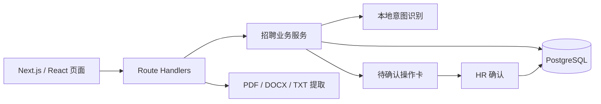

# TSIN · 招聘工作台

HR 用自然语言查询招聘信息、推进候选人阶段和安排面试。系统先整理操作，缺少信息时追问，确认后再更新数据。

当前版本不连接外部大模型、不需要模型 API Key。自然语言入口使用可替换的本地规则识别器；简历录入使用文本提取与规则抽取。它是面向作品展示的单机、单用户项目。

## 三个入口

- **招聘助手**：查询面试、待跟进、候选人阶段、岗位人数和最近记录；用自然语言推进阶段或安排面试。
- **简历入库**：上传文本 PDF、DOCX、UTF-8 TXT，或粘贴文本；核对字段、选择岗位并保存。技能提示只反映关键词是否出现。
- **候选人台账**：搜索与筛选档案，查看原文、原文件、招聘阶段和处理记录。

岗位配置放在轻量表单中。没有历史虚构图表、自动淘汰评分、企业微信/腾讯文档伪同步或独立 Agent 服务。

## 自然语言示例

首次创建数据库时初始化的候选人和岗位均为虚构资料。可以围绕实际台账中的名字描述进展，例如：

```text
明天有哪些面试？
林书妍现在是什么阶段？
AI应用工程师有多少候选人？
最近有哪些操作记录？
陈亦安一面通过，推进复试。
明天下午三点安排陈亦安一面。
```

信息不全时继续补充，例如先说“给周可欣安排复试”，再根据追问提供时间。同名候选人需要补充岗位或候选人 ID。操作卡中展示目标档案、具体变化和面试安排，点击“确认执行”后才生效。

这里支持的是常见招聘指令，不具备通用大模型的任意语句理解能力。无法识别或无法定位的数据会请求澄清，不会据此编造候选人或直接写入。

## 运行

要求：**Node.js 22.x 或 24.x**、pnpm 和 PostgreSQL。`.nvmrc` 记录本次开发环境版本。

先复制 `.env.example` 为 `.env.local`，填写 `DATABASE_URL`。可连接自己已有的 PostgreSQL；若已安装 Docker，也可使用项目的本地数据库配置：

```bash
docker compose up -d
```

等待数据库启动后，安装依赖、初始化表结构与虚构资料，再启动应用：

```bash
pnpm install --frozen-lockfile
pnpm db:init
pnpm dev
```

打开 <http://127.0.0.1:3001>。完成数据库配置与初始化后，Windows 本机也可双击 `Start-LocalDemo.cmd`；首次运行会安装依赖。

需要生产构建时：

```bash
pnpm build
pnpm start
```

数据库连接由 `DATABASE_URL` 指定，业务资料、操作记录和小文件原件都保存在 PostgreSQL。Docker 配置使用持久卷保存数据；运行期不会自动回填演示资料。所有业务读写经服务端 API，浏览器不保存业务主数据。

`examples/demo-resume.txt` 是虚构简历，可用于理解录入字段。文件上限 4 MB；扫描 PDF、图片 OCR 暂未实现。

## 架构



目录分工：

```text
src/app/                 页面、样式与 HTTP API
src/lib/types.ts         前后端共享数据契约
src/server/intent.ts     意图、日期与缺失信息补全
src/server/assistant.ts  查询、澄清、操作预览与确认
src/server/db.ts         数据结构、持久化与事务
src/server/resume.ts     文件提取与简历字段抽取
db/                     PostgreSQL 建表与虚构种子资料
scripts/init-db.mjs      显式初始化数据库
examples/                虚构示例
docs/architecture.md     完整处理链路与取舍
```

## 数据与边界

- 一份候选人档案代表一次岗位应聘，不承担全局人员身份管理。
- 日期按上海时区解释；面试日期和时间会显示在确认卡中供 HR 核对。
- 操作预览与执行分开；确认需要检查有效期和档案版本，避免旧卡覆盖新状态；重复确认按同一操作处理。
- 岗位匹配只给关键词提示，“未提及”不等于“不具备”。不输出虚构置信度或录用建议。
- 本地单用户版没有完整账号权限、访客数据隔离或企业级运维功能。公开在线部署需要另行处理访问权限与访客数据隔离。

## 开发与验证状态

本项目在此前的 [TSIN 招聘 Demo](https://github.com/Dumpling-yhy/TSIN-hr-demo) 基础上，使用 AI 辅助重新整理架构与实现，以自然语言招聘流程为核心。

**当前版本尚未执行构建、类型检查、数据库连接与初始化、浏览器测试或模型效果验证。以上是代码范围与设计说明，不代表已经通过运行验收。** 旧版的测试结果不适用于本版本。

仓库仅纳入源码、配置示例和虚构资料；`.env.local`、`.data/`、构建产物及依赖目录均由 `.gitignore` 排除。依赖安装需要访问包仓库；应用运行没有外部模型请求。

本项目不声称未经实测的准确率、时间节省或业务效果；原项目经验与本次 AI 辅助重构属于不同开发阶段。
