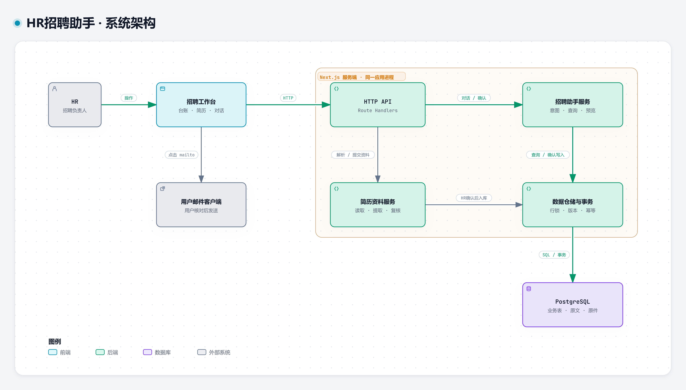
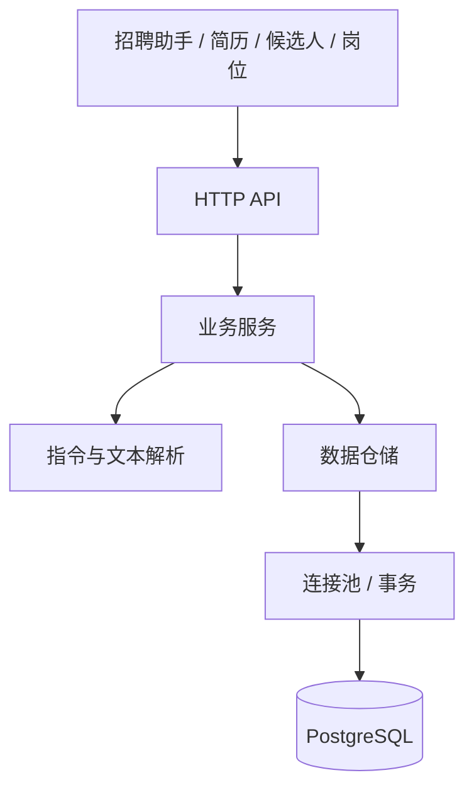

# 架构设计

HR招聘助手使用一个 Next.js 应用和一个 PostgreSQL 数据库。前端按业务功能组织，服务端按请求、业务与数据访问分层。

## 系统总览



[交互式架构图](diagrams/hr-assistant.html) · [可编辑源文件](diagrams/hr-assistant.architecture.json)

图中展示模块的运行关系。`server` 内的业务服务、解析器、仓储和连接池都属于同一 Next.js 进程，不对应独立部署的微服务。交互版下载后可用浏览器打开，图形使用 [Archify](https://github.com/tt-a1i/archify) 生成。

业务概念见 [领域词汇](domain.md)，其他说明见 [文档索引](README.md)。

## 目录与职责

```text
src/
├── app/
│   ├── _components/               工作台组合与布局
│   ├── api/                       HTTP 请求与响应
│   └── page.tsx                   页面入口
├── features/
│   ├── assistant/                 对话、补充信息与确认卡
│   ├── intake/                    简历录入与字段核对
│   ├── candidates/                候选人台账与档案
│   └── jobs/                      岗位配置
├── components/ui/                 公共小组件
├── hooks/                         工作区数据请求与刷新
├── lib/                           字段约定、技能别名、类型与公共工具
└── server/
    ├── db/                        PostgreSQL 连接池与事务
    ├── repositories/              查询、持久化与原子写入
    ├── services/                  招聘业务入口与流程编排
    ├── parsers/                   简历字段、招聘指令与日期时间解析
    ├── integrations/              招聘软件、企业微信接口与默认关闭的适配器
    ├── errors.ts                  统一业务错误
    └── validation.ts              输入校验
```

页面入口组合不同功能模块；功能模块使用共享类型、请求封装与公共组件。功能之间通过工作台回调与刷新协作，避免直接互相修改内部状态。

对话状态由工作台持有，独立对话页和右下角浮窗使用同一段历史、补充信息与邮件编辑状态。台账按视图、筛选、排序、分组与可见字段展示同一组应聘档案；行内操作携带档案 ID 打开助手。

服务端 API 读取和检查请求后调用业务服务。业务服务负责查询意图、资料定位、缺失信息和操作预览；仓储负责参数化 SQL 以及需要同一事务完成的写入。

## 请求链路



### 查询

HR 提问后，解析器提取查询类型、候选人、岗位与日期；业务服务从实际数据中查询并生成回答。资料不存在或存在同名档案时，先澄清目标。

### 流程推进

1. 识别候选人、目标阶段或面试安排。
2. 缺少信息时保留当前意图，等待下一句补充。
3. 定位唯一档案，保存待确认操作与当前档案版本。
4. 展示具体变更，由 HR 确认或取消。
5. 确认时检查状态、有效期与版本，并在同一事务中更新档案、面试和操作记录。

确认卡具有有效期；重复确认返回同一操作结果。档案已被其他操作更新时，旧确认卡不能覆盖新状态。

### 邀请邮件与外部系统

面试邀约仍通过预览与事务登记。需要邮件时，解析器同时保留收件人与抄送；确认结果包含邮件草稿，并与操作结果一同持久化，重复确认返回同一份草稿。

单独起草邮件可以引用已登记的面试，多场匹配时先补充日期或轮次；也可以只根据 HR 给出的信息起草，不新增面试。界面允许编辑收件人、抄送、主题和正文，通过 `mailto` 交给用户的邮件客户端处理。生成草稿不代表发送或送达。

招聘软件、企业微信通过独立适配器契约预留接入位置。默认实现返回 `INTEGRATION_DISABLED`，不发起网络请求。取得合作授权后需要实现目标系统适配器并配置凭证、数据范围和字段映射，详见 [外部系统接入](integrations.md)。

### 简历录入

简历处理分为文件读取、文本规范化与字段提取三步。文件适配器负责 PDF 文本层、DOCX 段落和 TXT 编码；纯文本解析器处理标签别名、同行字段、章节、技能写法和候选冲突，不依赖数据库或外部模型。

共享的 `src/lib/resume-schema.ts` 定义八个标准字段的含义、别名、长度上限和 JSON Schema。解析结果将标准值与提取依据分开：原文单独保留，清洗文本用于定位证据；每个字段有提取方式、候选值及“已提取 / 待核对 / 未找到”状态。状态表示规则判断，不是统计置信度。

HR 核对字段并选择岗位后，服务端从原件或原文重新提取，校验最终字段，再保存原文、原件、提取信息和人工修改的字段名。提取信息保存在 `candidates.resume_parse`；历史档案可为空，不改变原有字段读取方式。岗位技能提示使用核对后的技能及共享别名规则。

不同格式、字段语义和歧义处理详见 [简历解析](resume-parsing.md)。

## 数据模型

| 表 | 内容 |
| --- | --- |
| `jobs` | 岗位标题、JD 与关键技能 |
| `candidates` | 一次岗位应聘的资料、阶段、后续动作、原件及简历提取依据 |
| `interviews` | 面试轮次、日期、时间、面试官与地点 |
| `activities` | 入库、阶段更新与面试安排记录 |
| `pending_actions` | 待确认内容、预期版本、有效期与执行结果 |

文件上限为 4 MB，原件使用 PostgreSQL BYTEA，与档案一起持久化。招聘日期按上海时区解释，绝对时间以时间戳保存。

`pnpm db:init` 显式执行建表与初始化数据脚本。运行中的请求不会自动重建业务资料。

已有数据库通过 `pnpm db:migrate` 单独执行表结构变更，不插入演示资料。简历提取信息通过可空的增量列加入，历史档案保持兼容。

## 设计取舍

- 保持单应用部署，模块边界通过目录与职责表达。
- 当前指令识别器独立输出结构化意图。后续替换识别实现时，资料查找、人工确认和事务写入仍保留在业务层。
- 仅提取实际共享的组件与工具，业务文件放回所属功能目录。

## 组织方式参考

- [Bulletproof React · Project Structure](https://github.com/alan2207/bulletproof-react/blob/master/docs/project-structure.md)：按功能组织前端，以及共享模块到应用组合层的依赖方向。
- [Twenty](https://github.com/twentyhq/twenty)：以产品界面与功能说明组织项目入口文档。
- [Documenso](https://github.com/documenso/documenso)：区分产品介绍、技术栈与本地运行说明。
- [飞书多维表格 · 分组和筛选](https://www.feishu.cn/hc/zh-CN/articles/360049067904)：参考表格工具栏、分组和筛选的组织方式。
- [Archify](https://github.com/tt-a1i/archify)：架构图渲染与可编辑架构描述。
