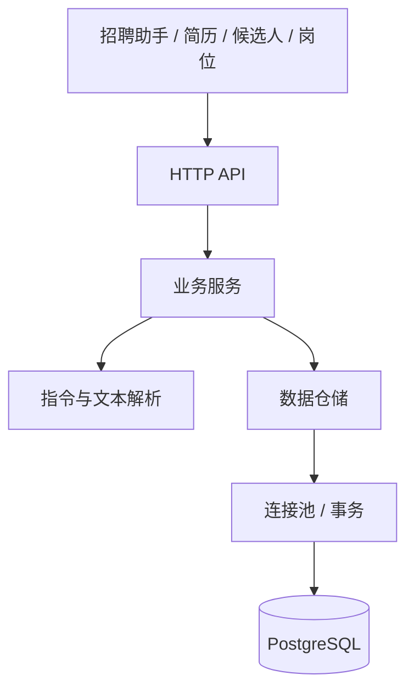

# 架构设计

HR Assistant 使用一个 Next.js 应用和一个 PostgreSQL 数据库。前端按业务功能组织，服务端按请求、业务与数据访问分层。

## 目录与职责

```text
src/
├── app/
│   ├── _components/               工作台组合与布局
│   ├── api/                       HTTP 请求与响应
│   └── page.tsx                   页面入口
├── features/
│   ├── assistant/                 对话、补充信息与确认卡
│   ├── intake/                    简历录入与字段核对
│   ├── candidates/                候选人台账与档案
│   └── jobs/                      岗位配置
├── components/ui/                 公共小组件
├── hooks/                         工作区数据请求与刷新
├── lib/                           类型、HTTP 客户端与格式化
└── server/
    ├── db/                        PostgreSQL 连接池与事务
    ├── repositories/              查询、持久化与原子写入
    ├── services/                  招聘业务入口与流程编排
    ├── parsers/                   招聘指令、日期与时间解析
    ├── errors.ts                  统一业务错误
    └── validation.ts              输入校验
```

页面入口组合不同功能模块；功能模块使用共享类型、请求封装与公共组件。功能之间通过工作台回调与刷新协作，避免直接互相修改内部状态。

服务端 API 读取和检查请求后调用业务服务。业务服务负责查询意图、资料定位、缺失信息和操作预览；仓储负责参数化 SQL 以及需要同一事务完成的写入。

## 请求链路



### 查询

HR 提问后，解析器提取查询类型、候选人、岗位与日期；业务服务从实际数据中查询并生成回答。资料不存在或存在同名档案时，先澄清目标。

### 流程推进

1. 识别候选人、目标阶段或面试安排。
2. 缺少信息时保留当前意图，等待下一句补充。
3. 定位唯一档案，保存待确认操作与当前档案版本。
4. 展示具体变更，由 HR 确认或取消。
5. 确认时检查状态、有效期与版本，并在同一事务中更新档案、面试和操作记录。

确认卡具有有效期；重复确认返回同一操作结果。档案已被其他操作更新时，旧确认卡不能覆盖新状态。

### 简历录入

文件提取保留文本 PDF 的换行，DOCX 与 TXT 读取原文，再按字段规则提取基础资料。HR 可以修改字段并选择岗位，确认后保存原文、原件和档案。岗位技能提示反映关键词出现情况。

## 数据模型

| 表 | 内容 |
| --- | --- |
| `jobs` | 岗位标题、JD 与关键技能 |
| `candidates` | 一次岗位应聘的资料、阶段、后续动作与原件 |
| `interviews` | 面试轮次、日期、时间、面试官与地点 |
| `activities` | 入库、阶段更新与面试安排记录 |
| `pending_actions` | 待确认内容、预期版本、有效期与执行结果 |

文件上限为 4 MB，原件使用 PostgreSQL BYTEA，与档案一起持久化。招聘日期按上海时区解释，绝对时间以时间戳保存。

`pnpm db:init` 显式执行建表与初始化数据脚本。运行中的请求不会自动重建业务资料。

## 设计取舍

- 保持单应用部署，模块边界通过目录与职责表达。
- 当前指令识别器独立输出结构化意图。后续替换识别实现时，资料查找、人工确认和事务写入仍保留在业务层。
- 仅提取实际共享的组件与工具，业务文件放回所属功能目录。

## 组织方式参考

- [Bulletproof React · Project Structure](https://github.com/alan2207/bulletproof-react/blob/master/docs/project-structure.md)：按功能组织前端，以及共享模块到应用组合层的依赖方向。
- [Twenty](https://github.com/twentyhq/twenty)：以产品界面与功能说明组织项目入口文档。
- [Documenso](https://github.com/documenso/documenso)：区分产品介绍、技术栈与本地运行说明。
