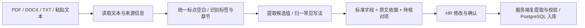

# 简历解析

候选人使用不同的模板和表达方式，系统将这些输入整理成同一组字段，供 HR 核对和后续流程使用。文件格式决定怎样读取文字，字段规则决定怎样解释文字；两者分开处理。

## 文件格式与文本读取

| 输入 | 处理 | 边界 |
| --- | --- | --- |
| 文本 PDF | 读取文本层，保留行与分页边界，并记录页数 | 复杂多栏、文字顺序异常仍需核对；没有可读取文字时提示转换为文字 |
| DOCX | 提取段落和表格内的文字，保留文本分隔 | 不复刻字体、边框和版式；图片中的文字需先转换 |
| TXT | 优先按 UTF-8 严格解码，识别带 BOM 的 UTF-16，必要时回退 GB18030 | 编码回退会显示提示；乱码需转换编码或改用粘贴文本 |
| 粘贴文本 | 直接进入规范化与字段提取 | 内容来源和准确性仍由提供者与 HR 核实 |

单份文件上限为 4 MB，PDF 最多 30 页，可读文本长度为 20—50,000 字符。图片和扫描件不自动调用 OCR，也不调用外部大模型 API。混合 PDF 中可读取文字很少的页面会提示核对，不能据此认定已读取整份简历。

## 标准字段约定

字段定义集中在 [`src/lib/resume-schema.ts`](../src/lib/resume-schema.ts)。它同时提供共享类型、标签别名、长度上限和 `RESUME_FIELDS_JSON_SCHEMA`，供提取、界面和入库校验使用。

| 字段 | 类型与空值 | 含义与提取原则 |
| --- | --- | --- |
| `name` | `string`，未知为 `""` | 候选人姓名；支持明确的中英文标签。页首姓名样式可作为待核对候选，不从文件名补姓名 |
| `phone` | `string`，未知为 `""` | 联系电话；整理常见空格、短横线和国家区号写法，不把任意数字串作为电话 |
| `email` | `string`，未知为 `""` | 电子邮箱；多次重复出现的同一邮箱去重，不默认选择多个不同邮箱中的第一个 |
| `city` | `string`，未知为 `""` | 当前居住城市；不使用籍贯、学校地址或意向城市代替 |
| `education` | `string`，未知为 `""` | 简历明确记载的最高教育层次，保留在读、预计毕业、肄业等状态 |
| `currentTitle` | `string`，未知为 `""` | 明确标注的现任职位；求职意向和已结束经历不能直接填入 |
| `yearsOfExperience` | `number \| null`，未知为 `null` | 明确陈述的累计工作年数，范围为 0—80；不从年龄、毕业时间、项目或实习跨度推算 |
| `skills` | `string[]`，未知为 `[]` | 简历明确提及的技能；统一常见别名，去重，保留具名技能列表中的其他名称 |

八个键始终存在。未知值留空，不用“未知”“暂无”或 `0` 代替缺失；`0` 只有在原文明示零工作年限时才有该含义。技能上限为 40 项，每项不超过 80 字。姓名、电话、邮箱、城市、教育层次、当前职位的长度上限分别为 60、40、150、80、200、120 字符。

JSON Schema 描述字段结构和范围；服务端运行校验还检查邮箱格式、技能列表和未知字段。姓名与申请岗位是保存档案所需信息，其他缺失字段可由 HR 补充或留空。合法的电话或邮箱格式不构成身份认证。

## 不同写法怎样映射

### 先整理文本，不改写事实

原始提取文本保存在 `rawText`，规范化后的文本保存在 `normalizedText`。规范化统一换行、全角标点、常见空白和不可见字符，保留内容顺序。字段提取识别同行标签的边界，分别读取对应内容。原文依据的行号指向规范化文本，不代表 PDF 或 Word 中的视觉行号。

### 识别别名、章节与字段边界

字段名按共享别名识别，例如“姓名 / Name / Full Name”“手机 / 联系电话 / Mobile”“技术栈 / Skills”。标签后可以跟随值，也可以独占一行、由下一行提供值；同一行出现多个标签时，前一个值在下一个标签处结束。

解析器结合教育、工作、技能等章节限定候选来源。章节帮助定位内容，不把整段经历直接塞进某个基础字段。规则无法确定归属时，保留待核对信息或留空。

| 简历表达 | 处理原则 |
| --- | --- |
| `姓名：沈予安　邮箱：shen@example.com` | 识别同行的两个标签，分别提取，不将邮箱并入姓名 |
| `现居上海，意向北京` | 现居和意向区分；不将北京覆盖到现居城市 |
| `硕士在读，预计 2027 年毕业` | 保留在读或预计毕业状态，不改写为已获硕士学位 |
| 本科、硕士两段教育经历 | 比较明确的教育层次并保留最高层次对应状态；不把两个层次当作联系方式式冲突 |
| `求职意向：后端研发` | 不写入 `currentTitle`；当前职位没有明确依据时留空 |
| `三年工作经验`、`3.5 years of experience` | 识别明确年数并归一为数值；范围或“以上”不强行压缩成精确数值 |
| 仅列出实习或项目起止日期 | 不累计成工作年限 |
| `JS / JavaScript`、`Postgres / PostgreSQL` | 同义技能归一并去重 |
| `JavaScript`、`MySQL` | 不因包含子串而额外提取 `Java`、`SQL` |
| `不会 Java，计划学习 Redis` | 否定和学习计划不作为已有技能 |

技能识别使用名称边界和常见别名。具名技能列表可以保留词典以外的名称；自然语言段落只识别已定义规则能够识别的技能，不声称理解任意行业术语。岗位对照同样按归一后的技能匹配，避免前后端使用不同口径。

## 提取依据与人工核对

标准字段与提取信息分开保存。每个字段对应以下信息：

| 信息 | 含义 |
| --- | --- |
| `status` | `found`：有规则依据；`review`：存在歧义或需要确认；`missing`：没有找到可用依据 |
| `method` | 标签、格式规则、章节、页首候选或未提取 |
| `evidence` | 规范化文本中的行号和原文片段 |
| `candidates` | 不重复的候选值，便于 HR 比较 |
| `note` | 冲突、缺失或规则处理的说明 |

这些状态是规则判断，不是基于标注样本计算的置信度。`found` 也不代表资料真实或不需核对。

单值字段存在多个互相冲突的候选时，字段留空并标记待核对；系统不静默采用首个号码或邮箱。页首姓名推断、含糊年限等也会保留说明。HR 可以在表单中修改，编辑后的内容与最初提取结果分开记录。

## 确认与持久化

1. 解析接口返回字段、原文、来源格式、Schema 版本、字段依据和整体提示。
2. HR 核对字段、处理冲突，并选择申请岗位。
3. 保存时，服务端从提交的原件或原文重新提取，不采用客户端上传的“已验证”结论。
4. 校验最终字段，并比较提取值与确认值，记录被修改的字段名。
5. 在同一次档案写入中保存最终字段、原文、原件与提取信息。

最终业务字段仍保存在 `candidates.fields_json`。`candidates.resume_parse` 保存版本、来源、规范化文本、字段依据、提示、`extractedFields` 和 `correctedFields`；历史档案没有提取记录时，该项为空。

已有数据库执行 `pnpm db:migrate` 补充表结构；该命令不插入演示资料，也不重写历史档案的提取记录。

这种划分允许后续调整提取规则，而无需改变候选人查询和招聘流程使用的字段。人工修改是本次录入的确认结果，不自动变成新的全局提取规则。

## 适用边界

- PDF 或 DOCX 提取出的阅读顺序可能受多栏、文本框或复杂表格影响，换行保留不能等同于完整的版面理解。
- 解析器处理明确标签、常见写法与有限上下文，不具备任意自然语言推理能力。
- 简历省略的信息不会补造；没有提到某技能不等于候选人不具备该技能。
- 姓名、联系方式、教育和工作经历的真实性需要在招聘流程中核实。

文件读取依据：[unpdf](https://github.com/unjs/unpdf)、[Mammoth](https://github.com/mwilliamson/mammoth.js)。字段结构说明参考 [JSON Schema 对象定义](https://json-schema.org/understanding-json-schema/reference/object)。
