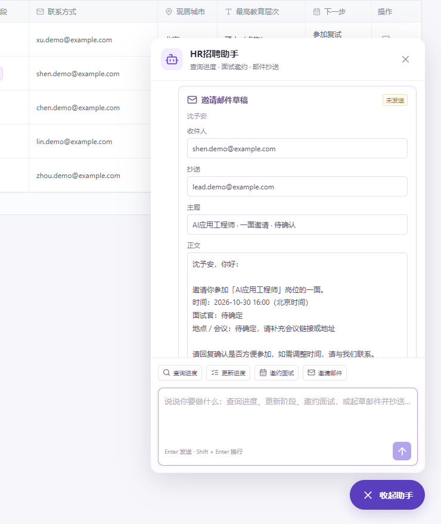

# 功能预览

页面中的候选人和资料均为虚构内容。

## 候选人台账

使用表格视图集中查看申请档案，按岗位和阶段筛选、排序与分组，并从记录旁打开招聘助手。

## 招聘对话

通过自然语言查询进度、更新阶段、补充面试信息，并核对具体安排。

## 邀请邮件

在台账中打开悬浮助手，编辑邀请邮件的收件人、抄送、主题与正文，再交给邮件客户端发送。

## 简历入库

上传文件或粘贴文本，将不同标签与写法提取成统一字段，核对后选择申请岗位并建立档案。

## 提取依据

展开字段依据，查看原文片段及其对应行号，核对现居城市、教育层次等信息。

[返回文档索引](README.md)
